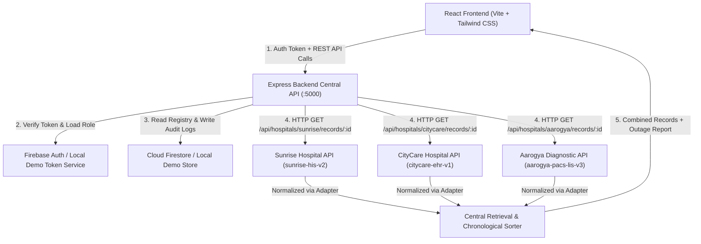
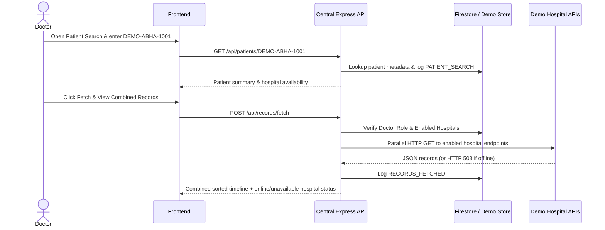

# PROJECT_GUIDE.md — Unified Medical Records Access Platform (MVP)

Welcome! This beginner-friendly guide explains everything about the **Unified Medical Records Access Platform**: how it works, how the code is organized, how to install and run it on your computer, how to test every feature (including Postman & automated tests), and how to deploy it to Netlify and Render.

> **Important MVP Disclaimer:**  
> This project is an academic college MVP built with **fictional ABHA-style IDs** (such as `DEMO-ABHA-1001`), **fictional hospitals**, and **synthetic medical records** in a simplified doctor-facing and hospital-facing workflow. It does **not** connect to the real ABDM/ABHA network or live hospital databases, and its sample reports must never be used as actual medical advice. **Real-world hospital deployment requires applicable patient authorization, strict privacy safeguards, and ABDM-compatible integration.**

---

## A. Project Explanation

### 1. What the Application Does
The **Unified Medical Records Access Platform** acts as a central **medical record exchange and access layer** connecting multiple independent hospital systems. Instead of forcing hospitals to replace their existing Hospital Information Software (HIS), the platform enables authenticated doctors to search a patient by fictional ABHA-style ID, queries each connected hospital's REST API, retrieves matching reports, normalizes their different formats into one standard view, and displays the patient's medical history in chronological order.

### 2. What Real-World Problem It Solves
In the real world, a patient often visits:
- Hospital A for a cardiology checkup and prescription,
- Hospital B for a pulmonary emergency or inpatient stay, and
- Diagnostic Lab C for blood tests, X-rays, MRI, or CT scans.

Because each facility keeps its own isolated database, when the patient visits a new doctor, that doctor cannot easily see previous test results or prescriptions. Patients have to carry heavy paper folders, call old hospitals, or repeat expensive tests.

### 3. Why This Platform Is Useful
- **Saves time during consultations:** Doctors get a single chronological medical timeline across all connected hospitals.
- **Reduces duplicate diagnostic tests:** Previously completed blood panels, X-rays, and MRIs are visible right away.
- **Protected & audited access:** Endpoints require authentication and role-based access control (`doctor` vs `hospital_admin`), and every search, record retrieval, and hospital management action is recorded in an access audit log.
- **Tolerates partial network failures:** If one hospital server goes offline, the platform still returns records from all online hospitals while clearly reporting which hospital was unavailable.

### 4. Who Will Use It
1. **Doctors (Main Users):** Log in securely, search patients by fictional ABHA-style ID, fetch combined medical records from connected hospitals, view unified chronological timelines, and expand record cards inline to inspect metadata, vitals, lab tables, medications, and notes.
2. **Hospitals / Hospital Administrators:** Register their hospital node, manage hospital details, enable/disable their API connection, simulate maintenance/outage states, and review shared records.

### 5. What Makes It Different from Manually Collecting Reports
| Manual Collection | Unified Medical Records Access Platform |
|---|---|
| Patient carries physical paper folders or searches WhatsApp/email | Doctor searches one ABHA-style ID in seconds |
| Reports arrive in mixed hospital layouts with no chronological order | Backend normalizes schemas and sorts all records chronologically |
| No visibility into who viewed a paper printout | Access & audit log tracks every search and retrieval |
| No unified view when a clinic system is down | Handles partial outages gracefully and clearly flags unavailable hospitals |

---

## B. Architecture

### 1. System Components
1. **Frontend (React + Vite + Tailwind CSS + React Router):** Runs on `http://localhost:5173`. Provides the clinical SaaS dashboard, patient search, unified timeline views with expandable record detail cards, hospital management, and audit logs.
2. **Backend (Node.js + Express REST API):** Runs on `http://localhost:5000`. Handles authentication verification, role-based access control (`doctor` vs `hospital_admin`), patient lookup, audit logging, and the central retrieval engine.
3. **Independent Demo Hospital APIs (Inside Express Gateway Routes):**
   - `GET /api/hospitals/sunrise/records/:patientId` (Sunrise Multispeciality Hospital — schema `sunrise-his-v2`)
   - `GET /api/hospitals/citycare/records/:patientId` (CityCare Medical Centre — schema `citycare-ehr-v1`)
   - `GET /api/hospitals/aarogya/records/:patientId` (Aarogya Diagnostic Centre — schema `aarogya-pacs-lis-v3`)
   When a doctor clicks **Fetch & View Combined Records**, the central backend service (`POST /api/records/fetch`) makes **real HTTP GET requests** to each enabled hospital API endpoint, normalizes their different JSON schemas using FHIR-inspired adapter functions, merges all records, and sorts them by date.
4. **Database & Auth (Firebase Cloud Firestore & Firebase Authentication + Local Demo Mode):**
   - When Firebase credentials are provided in `.env`, the backend verifies Firebase ID tokens via `firebase-admin` and stores platform state in Cloud Firestore collections.
   - When Firebase credentials are missing (out-of-the-box local run), the backend runs in **Local Demo Mode** using HMAC-signed tokens and a local JSON-backed synthetic store (`backend/data/demo-runtime-state.json`), and clearly displays a **Local Demo Mode** badge in the UI.

### 2. Architecture Diagram



### 3. Record Retrieval Sequence



---

## C. Folder Structure

```text
Field Project/
├── .gitignore                        # Ignores node_modules, .env, build outputs, runtime demo state
├── README.md                         # Quick overview and launch commands
├── PROJECT_GUIDE.md                  # This complete beginner guide
├── firebase.json                     # Firebase config pointing to Firestore rules
├── firestore.rules                   # Cloud Firestore security rules
├── netlify.toml                      # Netlify SPA build and redirect rules
├── render.yaml                       # Render backend web service configuration
├── backend/
│   ├── .env.example                  # Sample backend environment variables
│   ├── package.json                  # Backend dependencies and scripts (start, dev, test)
│   ├── tests/
│   │   └── api.integration.test.js   # Automated backend & integration test suite (node:test)
│   └── src/
│       ├── server.js                 # Server entry point (initializes Firebase/Demo store & starts Express)
│       ├── app.js                    # Express app setup, Helmet, CORS, routes, error handler
│       ├── config/
│       │   ├── env.js                # Loads .env and manages internal API base URL
│       │   └── firebaseAdmin.js      # Initializes Firebase Admin SDK or Local Demo fallback
│       ├── data/
│       │   ├── seedData.js           # 3 hospitals, 5 patients, demo doctors/admins, initial audit logs
│       │   └── hospitals/
│       │       ├── sunriseRecords.js # Independent Sunrise Hospital dataset (native schema)
│       │       ├── citycareRecords.js# Independent CityCare dataset (native schema)
│       │       └── aarogyaRecords.js # Independent Aarogya Diagnostics dataset (native schema)
│       ├── repositories/
│       │   └── dataStore.js          # Data access layer supporting both Firestore and Local Demo Store
│       ├── middleware/
│       │   ├── authMiddleware.js     # Verifies Firebase ID token or Local Demo token
│       │   ├── roleMiddleware.js     # Enforces doctor / hospital_admin RBAC
│       │   ├── validateMiddleware.js # Validates required request fields and emails
│       │   └── errorHandler.js       # Uniform JSON 404 & error responses
│       ├── services/
│       │   ├── demoTokenService.js   # Signs & verifies HMAC tokens for Local Demo Mode
│       │   ├── hospitalConnectorService.js # Makes HTTP calls to hospital APIs & normalizes schemas
│       │   ├── recordRetrievalService.js   # Central multi-hospital retrieval orchestration engine
│       │   └── auditLogService.js    # Appends non-sensitive audit entries to accessLogs
│       ├── controllers/              # Route handlers for auth, dashboard, hospitals, patients, records, logs, settings
│       └── routes/                   # Express route definitions mounted under /api
└── frontend/
    ├── .env.example                  # Sample frontend Vite environment variables
    ├── index.html                    # HTML entry point with Inter font
    ├── package.json                  # Frontend dependencies and Vite scripts
    ├── vite.config.js                # Vite configuration
    ├── tailwind.config.js            # Tailwind CSS theme configuration
    ├── postcss.config.js             # PostCSS configuration
    ├── public/
    │   └── _redirects                # Netlify SPA fallback redirect rule
    └── src/
        ├── main.jsx                  # React root mount
        ├── App.jsx                   # React Router routes for all 11 pages
        ├── index.css                 # Tailwind directives & reusable button/card classes
        ├── config/
        │   └── firebase.js           # Optional Firebase Web SDK initialization
        ├── context/
        │   └── AuthContext.jsx       # Global auth state, mode detection, login/register/logout, toasts
        ├── services/
        │   └── apiClient.js          # Fetch wrapper with Bearer token authentication
        ├── utils/
        │   └── formatters.js         # Date formatters, category colors, action labels
        ├── components/
        │   ├── common/               # ProtectedRoute, StatusBadge, DemoBanner, EmptyState, LoadingSpinner, ToastContainer
        │   ├── layout/               # DashboardLayout, Sidebar, Header
        │   └── records/              # RecordCard (expandable timeline record card)
        └── pages/                    # Login, Register, Dashboard, PatientSearch, PatientProfile, MedicalRecordsTimeline, HospitalManagement, ActivityLogs, DoctorProfile, Settings, NotFound
```

### Which Files to Modify for Future Changes
- **To add a new demo hospital or records:** Add a data file in `backend/src/data/hospitals/`, register its adapter in `backend/src/services/hospitalConnectorService.js`, and seed it in `backend/src/data/seedData.js`.
- **To change UI colors or button styles:** Edit `frontend/src/index.css` and `frontend/tailwind.config.js`.
- **To integrate real HL7 FHIR / ABDM gateways later:** Update `backend/src/services/hospitalConnectorService.js` (to call external FHIR URLs) and add an ABDM authorization & Consent Manager integration module before triggering record fetches.

---

## D. Installation

### Step 1: Install Node.js (if not already installed)
1. Download **Node.js LTS** (version 20 or newer; this project was built and verified on Node `v24.21.0`) from [nodejs.org](https://nodejs.org/).
2. Verify installation in a terminal:
   ```bash
   node -v
   npm -v
   ```

### Step 2: Open the Project in VS Code
1. Launch **Visual Studio Code**.
2. Click **File → Open Folder...** and select the project root folder (`Field Project`).
3. Open the VS Code integrated terminal (`Ctrl + ~` or **Terminal → New Terminal**).

### Step 3: Install Backend Dependencies
```bash
cd backend
npm install
```

### Step 4: Install Frontend Dependencies
Open a second terminal (or navigate from root):
```bash
cd frontend
npm install
```

### Step 5: Environment Files (`.env`)
The application works **out-of-the-box in Local Demo Mode** even if you do not configure Firebase keys. Still, creating `.env` files is good practice:

**Backend (`backend/.env`):**
Copy `backend/.env.example` to `backend/.env`:
```bash
# Windows PowerShell (from backend folder):
Copy-Item .env.example .env
```
Leave `FIREBASE_*` blank to run in **Local Demo Mode**, or fill them in after completing Step 6 below.

**Frontend (`frontend/.env`):**
Copy `frontend/.env.example` to `frontend/.env`:
```bash
# Windows PowerShell (from frontend folder):
Copy-Item .env.example .env
```

### Step 6: Configuring Firebase (Optional — Required Only for Live Cloud Firestore & Firebase Auth)
If you want to connect live Firebase Authentication and Cloud Firestore instead of Local Demo Mode:

1. Go to the [Firebase Console](https://console.firebase.google.com/) and click **Create a project**.
2. **Enable Firebase Authentication:**
   - Open **Build → Authentication → Get started**.
   - Under **Sign-in method**, enable **Email/Password** and click **Save**.
3. **Create Cloud Firestore Database:**
   - Open **Build → Firestore Database → Create database**.
   - Choose **Start in production mode** and select a nearby region (e.g., `asia-south1`).
   - Go to the **Rules** tab and paste the contents of `firestore.rules` from this repository, then click **Publish**.
4. **Firestore Collections Structure (auto-seeded on backend startup):**
   - `doctors`: `{ uid, name, email, role, medicalLicenseId, specialization, hospitalAffiliation, phone, createdAt }`
   - `hospitals`: `{ hospitalId, slug, name, location, apiEndpoint, isEnabled, systemStatus, specialties, contactEmail, updatedAt }`
   - `patients`: `{ patientId, fullName, age, gender, dob, bloodGroup, city, phoneMasked, emergencyNote, isDemo }`
   - `medicalRecordsMetadata`: `{ recordId, patientId, hospitalId, hospitalSlug, hospitalName, category, title, reportDate, fileFormat, isDemo }`
   - `accessLogs`: `{ logId, actorId, actorName, actorRole, patientId, hospitalSource, action, summary, timestamp }`
5. **Get Frontend Web Config (`frontend/.env`):**
   - In Project Settings → **Your apps** → Add Web App (`</>`).
   - Copy `apiKey`, `authDomain`, `projectId`, `storageBucket`, `messagingSenderId`, `appId` into `frontend/.env` (`VITE_FIREBASE_*`).
6. **Get Backend Service Account Key (`backend/.env`):**
   - In Project Settings → **Service accounts** → Click **Generate new private key**.
   - Copy `project_id`, `client_email`, and `private_key` into `backend/.env` (`FIREBASE_PROJECT_ID`, `FIREBASE_CLIENT_EMAIL`, `FIREBASE_PRIVATE_KEY` keeping `\n` escapes) and ensure `DEMO_MODE=false`.
   - **Security Warning:** Never place Firebase Admin private keys inside `frontend/`.

---

## E. How to Start the Application

You need **two separate terminals** running side-by-side (one for the Express backend, one for the Vite React frontend).

### Terminal 1 — Start the Backend
1. Open a terminal and enter the `backend` folder:
   ```bash
   cd backend
   npm start
   ```
2. **How to verify the backend is running:**
   You will see:
   ```text
   [SystemMode] Firebase Admin credentials missing. Running in Local Demo Mode with synthetic data.
   [Server] Unified Medical Records API running on http://localhost:5000
   [Server] Health check: http://localhost:5000/api/health
   ```
   Open `http://localhost:5000/api/health` in your browser—you should see JSON `{ "success": true, "status": "ok", ... }`.

### Terminal 2 — Start the Frontend
1. Open a **second** terminal and enter the `frontend` folder:
   ```bash
   cd frontend
   npm run dev
   ```
2. **How to verify the frontend is running:**
   You will see:
   ```text
   VITE v7.x.x  ready in ... ms
   ➜  Local:   http://localhost:5173/
   ```
3. Open **`http://localhost:5173`** in Chrome or Edge.

---

## F. How to Use the Application (Complete Walkthrough)

1. **Open the Website:** Navigate to `http://localhost:5173`. You will be redirected to `/login`.
2. **Log in as a Demo Doctor:** Under *Quick-Fill Demo Accounts*, click **Demo Doctor (Primary)** (`doctor@unifiedhealth.demo`) and click **Sign In**.
3. **Open the Dashboard:** You land on `/dashboard` showing KPI cards (Patients Searched, Connected Hospitals, Available Demo Records, Record Retrievals), category bars, hospital node statuses, recent searches, and recent audit activity.
4. **Go to Patient Search:** Click **Patient Search** in the left sidebar (the primary entry point for record lookup).
5. **Enter a Sample Patient ID:** Type `DEMO-ABHA-1001` in the search box and click **Search Patient** (or click the `DEMO-ABHA-1001` quick sample chip).
6. **View Patient Information:** You see **Aarav Kulkarni (Demo)** (`42 yrs • Male • O+`) along with the 3 connected hospitals holding records (`Sunrise Multispeciality Hospital` = 2 reports, `CityCare Medical Centre` = 2 reports, `Aarogya Diagnostic Centre` = 2 reports).
7. **Fetch Combined Records:** Click **Fetch & View Combined Records (6)**. You navigate directly to `/records/DEMO-ABHA-1001`, where the backend makes live HTTP GET calls to Sunrise, CityCare, and Aarogya endpoints, merges all 6 records, and sorts them chronologically.
8. **View Records from Multiple Hospitals:** Toggle between **Chronological Timeline**, **By Hospital**, and **By Report Type** tabs, and test filtering by category or hospital.
9. **Inspect Record Details Directly in Timeline:** Find *Complete Blood Count (CBC) & Lipid Profile (DEMO)* or *Chest X-Ray PA View (DEMO Synthetic Imaging)* and click **Show Details** directly on the timeline card. The card expands inline to show full record metadata (ID, hospital, report type, date & time, attending doctor, department, FHIR mapping), lab parameters, vitals/medications, and structured clinical summary notes without leaving the timeline.
10. **Check Access Logs:** Click **Access & Activity Logs** in the sidebar. You will see every action (`Patient Search`, `Combined Records Fetched`, `Hospital Status Changed`, etc.) with actor, patient ID, hospital source, and timestamp.
11. **Register or Disable a Demo Hospital:**
    - Click **Logout** in the top-right header.
    - On `/login`, click **Demo Hospital Administrator** (`admin@unifiedhealth.demo`) and click **Sign In**.
    - Open **Hospital Network** in the sidebar.
    - Click **Register New Hospital** to add a custom demo clinic, OR click **Disable Link** / **Simulate Outage** on *Sunrise Multispeciality Hospital* or *CityCare Medical Centre*.
12. **Test What Happens When a Hospital Is Unavailable:**
    - Leave one hospital set to **Simulate Outage** (`Offline / Unavailable`), log out, and sign back in as **Demo Doctor (Primary)**.
    - Open **Medical Records**, enter `DEMO-ABHA-1001`, and click **Fetch Combined Records**.
    - Result: Records from the online hospitals still load normally, while the **Unavailable / Disabled Hospitals** card highlights the offline hospital with the exact HTTP 503 outage message!
    - *(Tip: Visit **Settings & Diagnostics** anytime and click **Reset Demo State** to restore clean default seed data for another presentation.)*

---

## G. Demo Credentials and Sample IDs

### Demo User Accounts (Local Demo Mode)
| Role | Label | Email | Password | Permissions |
|---|---|---|---|---|
| `doctor` | Demo Doctor (Primary) | `doctor@unifiedhealth.demo` | `DemoDoctor@123` | Search patients, fetch combined records, inspect timeline metadata |
| `doctor` | Demo Doctor (Secondary) | `doctor2@unifiedhealth.demo` | `DemoDoctor@123` | Secondary clinician account for multi-doctor audit logs |
| `hospital_admin` | Demo Hospital Admin | `admin@unifiedhealth.demo` | `DemoAdmin@123` | Register/edit hospitals, enable/disable links, simulate outages, view shared inventory |

### Sample Synthetic Patients (For Authenticated Doctors)
| ABHA-Style ID | Patient Name | Hospitals with Records | Total Records | Key Sample Modalities |
|---|---|---|---|---|
| `DEMO-ABHA-1001` | Aarav Kulkarni (Demo) | Sunrise (2), CityCare (2), Aarogya (2) | 6 | CBC/Lipid Panel, Chest X-Ray Metadata, Cardiology Diagnosis, Prescription |
| `DEMO-ABHA-1002` | Priya Nair (Demo) | Sunrise (2), Aarogya (2) | 4 | HbA1c & Thyroid Panel, Lumbar Spine MRI Metadata, Discharge Summary, Prescription |
| `DEMO-ABHA-1003` | Rohan Deshmukh (Demo) | CityCare (2), Aarogya (2) | 4 | Brain MRI Metadata, LFT & Kidney Panel, Neurology Diagnosis, Immunization Record |
| `DEMO-ABHA-1004` | Meera Iyer (Demo) | Sunrise (2), CityCare (1) | 3 | Orthopedic Assessment, Physiotherapy Plan, Vitamin D Prescription |
| `DEMO-ABHA-1005` | Vikram Joshi (Demo) | Sunrise (1), CityCare (1), Aarogya (1) | 3 | Abdominal CT Metadata, GI Follow-Up Note, Post-Surgical Discharge Summary |

---

## H. How to Test the Project

### Running Automated Tests
```bash
# Backend & API Integration Test Suite (12 automated tests)
cd backend
npm test

# Frontend Production Build Verification
cd frontend
npm run build
```

### Verified Testing Checklist

| # | Test Name | Steps to Perform | Expected Result | Status |
|---|---|---|---|---|
| 1 | Health Check | Call `GET /api/health` | Returns `200 OK` with `status: "ok"` and active mode | **PASS** |
| 2 | Unauthorized Access Block | Call `/api/dashboard/summary`, `/api/patients/DEMO-ABHA-1001`, `/api/records/fetch`, `/api/logs` without token | Returns `401 AUTH_TOKEN_MISSING` | **PASS** |
| 3 | Invalid Login | Submit wrong password on `/login` | Returns `401` and displays error message | **PASS** |
| 4 | Doctor & Admin Login | Sign in via demo accounts | Redirects to `/dashboard` with role badge | **PASS** |
| 5 | Doctor Registration Validation | Submit invalid email/short password on `/register` | Returns `400` validation error; valid input returns `201` | **PASS** |
| 6 | Role-Based Access Control | Doctor calls `POST /api/hospitals`; Admin calls `POST /api/records/fetch` | Blocked with `403 FORBIDDEN_ROLE` | **PASS** |
| 7 | Patient Search (Valid & Invalid) | Search `DEMO-ABHA-1001` then `DEMO-ABHA-9999` | `1001` shows 3 hospitals / 6 reports; `9999` returns `404` | **PASS** |
| 8 | Individual Hospital Endpoints | Call `/api/hospitals/sunrise`, `citycare`, `aarogya` for `DEMO-ABHA-1001` | Each returns its own native HIS schema & 2 records | **PASS** |
| 9 | Obsolete Routes Removed | Call `/api/consents` or `/api/reports/AAR-REC-301` or `/api/reports/AAR-REC-301/file` | Returns `404 ROUTE_NOT_FOUND` | **PASS** |
| 10 | Direct Combined Fetch & Merge | Doctor calls `POST /api/records/fetch` for `DEMO-ABHA-1001` | Returns 6 combined records with metadata & structured details sorted newest-first | **PASS** |
| 11 | Expandable Timeline Details | Click **Show Details** on a Timeline card (`RecordCard`) | Expands inline metadata grid, lab values, medications, vitals & notes | **PASS** |
| 12 | Disabled & Offline Hospital | Admin disables Sunrise & sets CityCare offline; Doctor fetches `1001` | Returns Aarogya records (2) and lists 2 unavailable hospitals (`503`) | **PASS** |
| 13 | Access Logs Generation | Open `/logs` after search & record fetch | Displays chronological audit entries cleanly | **PASS** |
| 14 | Production Build & Browser UI | Run `npm run build` + headless Chrome desktop & mobile E2E check | Clean build, responsive layout, zero console errors | **PASS** |

---

## I. Postman Testing

Base URL (Local): `http://localhost:5000/api`

### 1. Health Check
- **Method & Endpoint:** `GET /api/health`
- **Headers:** None
- **Expected Response (`200 OK`):**
  ```json
  {
    "success": true,
    "status": "ok",
    "service": "Unified Medical Records Access Platform API",
    "mode": "local-demo",
    "firebaseConfigured": false
  }
  ```

### 2. Doctor Login (Get Bearer Token)
- **Method & Endpoint:** `POST /api/auth/login`
- **Headers:** `Content-Type: application/json`
- **Body:**
  ```json
  {
    "email": "doctor@unifiedhealth.demo",
    "password": "DemoDoctor@123"
  }
  ```
- **Expected Response (`200 OK`):** Returns `"token": "<JWT>"` and `"user"`. Copy the token for all requests below (`Authorization: Bearer <JWT>`).
- **Error Response (`401 Unauthorized`):** `{ "success": false, "code": "INVALID_CREDENTIALS", "message": "Invalid email or password." }`

### 3. Search Patient
- **Method & Endpoint:** `GET /api/patients/DEMO-ABHA-1001`
- **Headers:** `Authorization: Bearer <DOCTOR_TOKEN>`
- **Expected Response (`200 OK`):** Returns `patient`, `totalAvailableReports: 6`, and `availableHospitals` (3 hospitals).
- **Error Response (`404 Not Found`):** For `DEMO-ABHA-9999`, returns `{ "success": false, "code": "PATIENT_NOT_FOUND", ... }`.

### 4. Direct Hospital Endpoint (Hospital A: Sunrise)
- **Method & Endpoint:** `GET /api/hospitals/sunrise/records/DEMO-ABHA-1001`
- **Headers:** `Authorization: Bearer <DOCTOR_TOKEN>`
- **Expected Response (`200 OK`):** Returns `{ "hospitalId": "HOSP-SUNRISE", "schemaFormat": "sunrise-his-v2", "recordCount": 2, "records": [...] }`.
- **Error Response (`503 Service Unavailable`):** When Sunrise is disabled or offline, returns `{ "success": false, "code": "HOSPITAL_GATEWAY_OFFLINE", ... }`.

### 5. Central Combined Medical Record Fetch
- **Method & Endpoint:** `POST /api/records/fetch`
- **Headers:** `Authorization: Bearer <DOCTOR_TOKEN>`, `Content-Type: application/json`
- **Body:**
  ```json
  {
    "patientId": "DEMO-ABHA-1001"
  }
  ```
- **Expected Response (`200 OK`):** Returns `summary` (`totalRecords`, `successfulHospitals`, `unavailableHospitals`, `retrievedAt`) and merged chronological `records` array.

### 6. Toggle Hospital Outage (Hospital Admin Token Required)
- **First login as Admin:** `POST /api/auth/login` with `admin@unifiedhealth.demo` / `DemoAdmin@123`.
- **Method & Endpoint:** `PATCH /api/hospitals/HOSP-CITYCARE/status`
- **Headers:** `Authorization: Bearer <ADMIN_TOKEN>`, `Content-Type: application/json`
- **Body:** `{ "systemStatus": "offline" }`
- **Error Response if Doctor tries (`403 Forbidden`):** `{ "success": false, "code": "FORBIDDEN_ROLE", ... }`.

### 7. Fetch Activity Logs
- **Method & Endpoint:** `GET /api/logs?patientId=DEMO-ABHA-1001`
- **Headers:** `Authorization: Bearer <DOCTOR_TOKEN>`
- **Expected Response (`200 OK`):** Returns `{ "success": true, "total": ..., "logs": [...] }`.

---

## J. Common Problems and Fixes

1. **`npm install` fails or hangs:**
   - Check internet connection and Node version (`node -v` should be 18+).
   - Clear npm cache (`npm cache clean --force`) and retry inside `backend/` or `frontend/`.
2. **Port `5000` or `5173` already in use (`EADDRINUSE`):**
   - Another terminal or app is already using that port. Close the old terminal, or change `PORT=5001` in `backend/.env` (and update `VITE_API_BASE_URL=http://localhost:5001/api` in `frontend/.env`).
3. **Firebase configuration errors (`Could not parse private key`):**
   - Make sure `FIREBASE_PRIVATE_KEY` in `backend/.env` is wrapped in double quotes with literal `\n` characters, or clear `FIREBASE_*` variables to revert to Local Demo Mode.
4. **Backend connection error (`Cannot connect to backend server at http://localhost:5000/api`):**
   - Make sure Terminal 1 (`cd backend && npm start`) is running before logging in on the frontend.
5. **CORS errors in browser console:**
   - Ensure `FRONTEND_URL` in `backend/.env` matches your exact frontend origin (e.g., `http://localhost:5173` locally or `https://your-site.netlify.app` in production, with no trailing slash).
6. **Invalid login error:**
   - Verify exact demo passwords (`DemoDoctor@123` or `DemoAdmin@123`) or use the **Quick-Fill Demo Accounts** buttons on the login screen. Note: if you registered a new user while in Local Demo Mode, it is saved in `backend/data/demo-runtime-state.json`.
7. **Patient not found (`404`):**
   - Use only the fictional demo IDs: `DEMO-ABHA-1001` through `DEMO-ABHA-1005`.
8. **No hospital records found during fetch:**
   - Check **Hospital Network** as Admin to ensure hospitals are not disabled or set to offline.
9. **Combined records return `403 FORBIDDEN_ROLE`:**
   - Ensure you are signed in with a Doctor account (`doctor@unifiedhealth.demo`), as `hospital_admin` accounts cannot fetch clinical patient records.

---

## K. Deployment Guide (GitHub, Render & Netlify)

*(Do not deploy without your own GitHub, Render, and Netlify accounts ready.)*

### 1. Push Code to GitHub
```bash
git init
git add .
git commit -m "Unified Medical Records Access Platform MVP"
git branch -M main
git remote add origin https://github.com/<your-username>/unified-medical-records-platform.git
git push -u origin main
```
Verify `.env` and `node_modules/` are NOT committed (`.gitignore` excludes them).

### 2. Deploy Backend on Render
1. Sign in to [render.com](https://render.com/) → Click **New + → Web Service**.
2. Connect your GitHub repository.
3. Configure:
   - **Root Directory:** `backend`
   - **Runtime:** `Node`
   - **Build Command:** `npm install`
   - **Start Command:** `npm start`
   - **Health Check Path:** `/api/health`
4. Add **Environment Variables** in Render:
   - `NODE_ENV` = `production`
   - `DEMO_MODE` = `true` *(or `false` if you add Firebase Admin credentials)*
   - `JWT_SECRET` = *(a long random secret string)*
   - `EXCHANGE_GATEWAY_KEY` = *(a random key string)*
   - `FRONTEND_URL` = `https://<your-netlify-site>.netlify.app` *(update once Netlify URL is created)*
5. Deploy and note your Render URL (e.g., `https://unified-medical-records-api.onrender.com`). Test `https://your-render-url.onrender.com/api/health`.

### 3. Deploy Frontend on Netlify
1. Sign in to [netlify.com](https://www.netlify.com/) → Click **Add new site → Import an existing project**.
2. Connect your GitHub repository (`netlify.toml` in the root already configures `base = "frontend"`, `command = "npm run build"`, `publish = "dist"`, and SPA redirects!).
3. Add **Environment Variables** in Netlify (**Site configuration → Environment variables**):
   - `VITE_API_BASE_URL` = `https://unified-medical-records-api.onrender.com/api`
   - *(Optional, if using Firebase)* add `VITE_FIREBASE_*` keys.
4. Click **Deploy site**.
5. Copy your new Netlify URL (`https://your-site.netlify.app`), paste it into Render's `FRONTEND_URL` variable, and redeploy/restart Render so CORS permits your Netlify domain.

### 4. Test Deployed Application
1. Open your Netlify URL.
2. Verify the status badge shows backend connectivity.
3. Log in with `doctor@unifiedhealth.demo` / `DemoDoctor@123`, search `DEMO-ABHA-1001`, fetch combined records, and expand timeline cards to verify metadata & structured details.

---

## L. Project Limitations and Future Scope

### 1. What Currently Works
- Full-stack React + Express + dual-mode Firebase/Local Demo backend.
- Doctor & Hospital Admin authentication, registration, and role-based access control.
- 3 independent demo hospital REST endpoints with distinct native schemas and FHIR-inspired normalization adapters.
- Authenticated combined record retrieval with real HTTP error/outage tolerance and chronological sorting.
- Expandable Medical Records Timeline cards displaying report metadata, vitals, laboratory tables, medications, and summary notes.
- Platform access & audit activity logs.

### 2. What Is Simulated / Simplified for MVP
- **Patient Identifiers:** Fictional `DEMO-ABHA-*` IDs are used instead of real ABHA addresses.
- **Hospital Systems:** Hospital endpoints live inside the Express gateway backed by synthetic datasets rather than external hospital HIS servers.
- **Simplified Authorization Workflow:** Patient consent and authorization screens were intentionally omitted from this MVP to keep the college demo focused on doctor search and multi-hospital data aggregation. All endpoints still require valid authentication and role checks (records are never exposed publicly).

### 3. What Is Not Implemented Yet
- Live ABDM Sandbox API integration (Gateway, HIU/HIP registration, Consent Manager).
- Patient authorization workflow, granular record scopes, and time-limited consent artifacts.
- End-to-end encrypted data transfer with ABDM Fidelius (ECDHE) key exchange.
- DICOM medical image parsing (Orthanc / OHIF viewer) for real hospital PACS scans.
- Multi-factor authentication (MFA) for clinicians.

### 4. Path to Real ABDM & HL7 FHIR Integration
- **Patient Authorization & ABDM Integration:** Real-world deployment **must** implement applicable patient authorization, privacy safeguards, and ABDM-compatible Consent Manager integration (register as a Health Information User / HIU with NHA ABDM, trigger `/v0.5/consent-requests/init`, verify signed consent artifacts via webhook callbacks, and enforce date-range/record-type scopes before fetching clinical data).
- **HL7 FHIR R4:** Upgrade `hospitalConnectorService.js` adapters to ingest standard FHIR `Bundle` resources (`Patient`, `DiagnosticReport`, `DocumentReference`, `MedicationRequest`, `Observation`).
- **Real Hospital Onboarding:** Each real hospital runs a Health Information Provider (HIP) bridge behind mutual TLS (mTLS) and OAuth2 client credentials, rather than static local JSON data.
- **Compliance & Security:** Enforce HIPAA/DISHA/DPDP Act safeguards, encrypted-at-rest clinical storage, consent expiry timers, and immutable audit trail verification.

