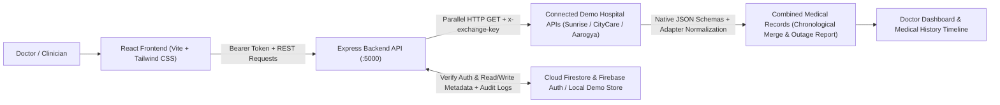

# Unified Medical Records Access Platform


---

## Introduction

In modern healthcare, a patient's medical journey rarely happens inside a single building. Blood work is often done at a diagnostic center, specialist consultations happen at one hospital, and emergency admissions or imaging scans occur at another. Because each hospital operates its own isolated record-keeping software, a patient's clinical history becomes fragmented across unconnected systems.

The **Unified Medical Records Access Platform** is a full-stack medical record exchange and access layer designed to bridge those silos. Rather than replacing hospital management software, it connects multiple independent hospital REST APIs, normalizes heterogeneous record schemas, and presents a patient's unified medical history in a single dashboard for authorized clinicians.

> **Note:** For detailed step-by-step walkthroughs, Postman payloads, and Render/Netlify deployment instructions, see [PROJECT_GUIDE.md](./PROJECT_GUIDE.md).

---

## Problem Statement

When a patient visits a new doctor at a different clinic or hospital, clinicians frequently face several obstacles:

- **Scattered Records:** Prescriptions, blood test panels, X-rays, MRIs, diagnosis notes, and discharge summaries remain locked inside previous hospitals' separate Hospital Information Systems (HIS).
- **Incomplete Clinical Context:** Doctors lack an immediate chronological view of prior conditions, medications, and diagnostic trends during time-sensitive consultations.
- **Repeated Tests & Delays:** Patients must carry physical folders of paper reports, manually request records from old hospitals, or repeat expensive lab investigations and imaging scans.
- **Inconsistent Data Formats:** Different hospital software vendors structure clinical reports with incompatible field names and schemas, making unified inspection difficult.

---

## Solution

This platform provides a central **clinical aggregation gateway** that sits above connected demo hospital endpoints:

1. **Unified Clinician Lookup:** Authenticated doctors search for a patient using a fictional ABHA-style identifier (e.g., `DEMO-ABHA-1001`) to discover which connected hospitals hold records.
2. **Parallel Multi-Hospital Retrieval:** On request, the Express backend issues parallel HTTP `GET` calls to each enabled demo hospital REST endpoint (`/api/hospitals/sunrise/records/:patientId`, `/api/hospitals/citycare/records/:patientId`, `/api/hospitals/aarogya/records/:patientId`, plus any admin-registered demo nodes).
3. **FHIR-Inspired Schema Normalization:** Dedicated adapter functions normalize incompatible hospital JSON schemas (`sunrise-his-v2`, `citycare-ehr-v1`, `aarogya-pacs-lis-v3`) into a consistent exchange format mapped to FHIR-inspired resource types (`DiagnosticReport`, `MedicationRequest`, `DocumentReference`).
4. **Outage Tolerance:** If a connected hospital link is disabled or offline (`HTTP 503`), the engine still returns records from all responsive hospitals while explicitly listing unavailable endpoints.
5. **Interactive Timeline & Inline Inspection:** Merged records are sorted newest-first into an interactive dashboard timeline where doctors can filter records and expand inline cards to inspect metadata, vitals, laboratory tables, medication schedules, and summary notes.

---

## Key Features

All features below are implemented and verified in the current codebase:

- **Role-Based Doctor & Hospital Admin Authentication:** Secure login and registration supporting **Firebase Authentication & Cloud Firestore** when configured, with an explicit out-of-the-box **Local Demo Mode** using HMAC-SHA256 signed tokens (`doctor` and `hospital_admin` roles).
- **Clinical Overview Dashboard:** Displays real-time KPIs (Patients Searched, Connected Hospitals & Online Count, Available Demo Records, Combined Retrievals Logged), category distribution bars, recent patient lookups, hospital API health cards, and recent audit activity.
- **Patient Search & Profile Discovery:** Search synthetic patients by fictional ABHA-style ID (`DEMO-ABHA-1001` – `DEMO-ABHA-1005`), inspect masked demographics and emergency notes, browse the synthetic patient directory, and see per-hospital record counts prior to retrieval.
- **Multi-Hospital Record Retrieval Engine:** Central `POST /api/records/fetch` endpoint restricted to `doctor` accounts that queries enabled hospital REST gateways in parallel via `x-exchange-key`, measures latency per endpoint, handles simulated `503` outages gracefully, and logs retrieval metrics.
- **Medical History Timeline & Expandable Record Metadata Cards:** Switch across **Chronological Timeline**, **By Hospital**, and **By Report Type** views; search and filter by report category or hospital; expand individual cards (**Show Details** / **Hide Details**) to view full metadata (Record ID, Hospital Name & ID, Report Type, Date & Time, Attending Clinician, Department, File Format, FHIR Resource Type), recorded vitals, lab tables, medications, and narrative summary notes directly inline.
- **Hospital Network & API Management:** Hospital Admins can register new demo hospitals (`POST /api/hospitals`), edit hospital metadata (`PUT /api/hospitals/:hospitalId`), toggle gateway connectivity (`isEnabled`), simulate online/offline outages (`PATCH /api/hospitals/:hospitalId/status`), and inspect shared record inventories.
- **Access & Audit Activity Logs:** Automatically records `PATIENT_SEARCH`, `RECORDS_FETCHED`, `USER_LOGIN`, `USER_REGISTERED`, `HOSPITAL_REGISTERED`, `HOSPITAL_UPDATED`, and `HOSPITAL_STATUS_CHANGED` events with Patient ID and Action Type filters.
- **Profile & System Diagnostics Settings:** Allows users to update profile credentials (`PUT /api/auth/me`), verify active database/auth mode, inspect FHIR adapter & ABDM readiness indicators, view live hospital endpoint status, and reset Local Demo Mode data (`POST /api/settings/reset-demo`).

---

## Technology Stack

| Layer | Technologies Used |
|---|---|
| **Frontend** | React 18 (`^18.3.1`), JavaScript (ES Modules), Vite 7 (`vite build`), HTML5, CSS3, Tailwind CSS (`^3.4.17`), React Router DOM (`^7.1.1`), Lucide React (`^0.468.0`) |
| **Backend** | Node.js, Express.js (`^4.21.2`), REST APIs, Helmet (`^8.0.0`), CORS (`^2.8.5`), dotenv (`^16.4.7`) |
| **Database & Authentication** | Firebase Cloud Firestore & Firebase Authentication (`firebase-admin` `^13.0.2`, `firebase` Web SDK `^11.1.0`), plus Local Demo Mode fallback (HMAC-SHA256 tokens + local runtime JSON persistence) |
| **Testing & Deployment Config** | Node.js built-in test runner (`node --test`), Netlify (`netlify.toml`), Render (`render.yaml`), Firestore Security Rules (`firestore.rules`) |

---

## System Architecture



### Architectural Highlights

- **Independent Hospital Schemas & Adapters:** Each built-in demo hospital returns its own distinct JSON field structure (`sunrise-his-v2`, `citycare-ehr-v1`, `aarogya-pacs-lis-v3`) in `backend/src/data/hospitals/`. `hospitalConnectorService.js` normalizes all responses into a unified model.
- **Dual-Mode Persistence & Auth:** When Firebase Admin credentials (`FIREBASE_*`) and Web SDK (`VITE_FIREBASE_*`) keys are configured with `DEMO_MODE=false`, requests authenticate via Firebase ID tokens and read/write Cloud Firestore (`doctors`, `hospitals`, `patients`, `medicalRecordsMetadata`, `accessLogs`). When left unconfigured, the server explicitly enters **Local Demo Mode**.

---

## Application Workflow

1. **Authenticate:** A Doctor or Hospital Admin signs in at `/login` (or registers at `/register`). The backend verifies credentials via Firebase Auth or Local Demo Mode and establishes an authenticated session.
2. **Explore Dashboard:** On `/dashboard`, the user views platform KPIs, record categories, connected hospital endpoint statuses, recent patient lookups, and audit events.
3. **Search Patient:** On `/patients/search`, the Doctor enters a fictional ABHA-style ID (e.g., `DEMO-ABHA-1001`) or selects one from the quick chips / directory. The backend returns demographics and a breakdown of hospitals holding reports, logging a `PATIENT_SEARCH` audit event.
4. **Trigger Multi-Hospital Retrieval:** Clicking **Fetch & View Combined Records** opens `/records/DEMO-ABHA-1001` and invokes `POST /api/records/fetch`.
5. **Aggregate & Normalize:** The central retrieval engine fetches records over HTTP from all enabled hospital endpoints in parallel, isolates any disabled or offline (`503`) hospitals, normalizes all records, sorts them newest-first, and appends a `RECORDS_FETCHED` audit log entry.
6. **Inspect Timeline & Details:** The Doctor reviews the combined records using **Chronological Timeline**, **By Hospital**, or **By Report Type** views, filters by category/hospital/text, and expands cards inline (**Show Details**) to inspect metadata, vitals, lab results, medications, and summary notes.
7. **Administer Hospital Links & Review Logs:** A Hospital Admin can manage nodes or simulate an outage on `/hospitals`, and authorized users can audit platform activity on `/logs`.

---

## Project Structure

```text
unified-medical-records-platform/
├── .gitignore                             # Excludes node_modules, dist, .env*, keys, demo runtime state
├── firebase.json                          # Firebase configuration referencing firestore.rules
├── firestore.rules                        # Cloud Firestore security rules enforcing RBAC
├── netlify.toml                           # Netlify frontend build & SPA redirect rules
├── render.yaml                            # Render backend web service configuration
├── README.md                              # Repository documentation
├── PROJECT_GUIDE.md                       # Detailed setup, Postman & deployment guide
├── backend/
│   ├── .env.example                       # Sample backend environment configuration
│   ├── package.json                       # Backend scripts (start, dev, test) & dependencies
│   ├── tests/
│   │   └── api.integration.test.js        # 12 automated API & RBAC integration tests
│   └── src/
│       ├── server.js                      # Initializes Firebase/Demo store and starts Express
│       ├── app.js                         # Configures Helmet, CORS, routes & error handling
│       ├── config/
│       │   ├── env.js                     # Environment loader & internal API URL helpers
│       │   └── firebaseAdmin.js           # Firebase Admin SDK / Local Demo Mode initializer
│       ├── controllers/                   # Route handlers (auth, dashboard, hospitals, patients, records, logs, settings)
│       ├── data/
│       │   ├── seedData.js                # Initial demo accounts, 3 hospitals, 5 patients & seed logs
│       │   └── hospitals/                 # Independent native hospital datasets (Sunrise, CityCare, Aarogya)
│       ├── middleware/                    # Token verification, RBAC guard, field validation & error handler
│       ├── repositories/
│       │   └── dataStore.js               # Unified data layer for Firestore & Local Demo store
│       ├── routes/                        # Express REST routers mounted under /api
│       └── services/                      # Token signing, hospital HTTP connector, retrieval engine & audit logging
└── frontend/
    ├── .env.example                       # Sample frontend Vite environment variables
    ├── index.html                         # HTML entry point
    ├── package.json                       # Frontend dependencies & Vite scripts
    ├── postcss.config.js                  # PostCSS plugins configuration
    ├── tailwind.config.js                 # Tailwind CSS theme configuration
    ├── vite.config.js                     # Vite bundler configuration
    ├── public/
    │   └── _redirects                     # Netlify SPA fallback route
    └── src/
        ├── main.jsx                       # React DOM mount
        ├── App.jsx                        # Protected & public React Router routes
        ├── index.css                      # Tailwind directives & shared UI utility classes
        ├── config/firebase.js             # Optional Firebase Web SDK initialization
        ├── context/AuthContext.jsx        # Authentication state, mode awareness & toast alerts
        ├── services/apiClient.js          # HTTP client attaching Bearer tokens
        ├── utils/formatters.js            # Date, category badge & audit action formatters
        ├── components/
        │   ├── common/                    # ProtectedRoute, StatusBadge, DemoBanner, EmptyState, LoadingSpinner, ToastContainer
        │   ├── layout/                    # DashboardLayout, Header, Sidebar
        │   └── records/                   # RecordCard (expandable metadata & clinical details card)
        └── pages/                         # Login, Register, Dashboard, PatientSearch, PatientProfile, MedicalRecordsTimeline, HospitalManagement, ActivityLogs, DoctorProfile, Settings, NotFound
```

---

## Installation and Setup

### Prerequisites
- **Node.js** v18+ (verified on Node `v24.21.0` and npm `11.19.0`)
- **Git**

### 1. Clone the Repository

```bash
git clone https://github.com/iamshravanijadhav/unified-medical-records-platform.git
cd unified-medical-records-platform
```

### 2. Install Backend Dependencies

```bash
cd backend
npm install
```

### 3. Install Frontend Dependencies

```bash
cd ../frontend
npm install
```

### 4. Configure Environment Variables

The application runs **out-of-the-box in Local Demo Mode** without external credentials. To customize local ports or prepare Firebase configuration, copy the example templates:

```bash
# Inside backend/
cp .env.example .env      # PowerShell: Copy-Item .env.example .env

# Inside frontend/
cp .env.example .env      # PowerShell: Copy-Item .env.example .env
```

### 5. Optional: Configure Live Firebase Authentication & Cloud Firestore

Leave all `FIREBASE_*` and `VITE_FIREBASE_*` values blank to use **Local Demo Mode**. To connect a live Firebase project instead:

1. Create a project in the [Firebase Console](https://console.firebase.google.com/).
2. Enable **Authentication → Sign-in method → Email/Password**.
3. Create a **Cloud Firestore** database and publish the rules from [firestore.rules](./firestore.rules).
4. Add a **Web App** in Project Settings and copy its keys into `frontend/.env` (`VITE_FIREBASE_*`).
5. Under **Project Settings → Service accounts**, generate a private key JSON and copy `project_id`, `client_email`, and `private_key` (with escaped `\n` newlines) into `backend/.env`, keeping `DEMO_MODE=false`. Never commit `.env` or service account JSON files.

### 6. Start the Application Locally

Run the backend and frontend in two separate terminals from the project root:

**Terminal 1 — Backend Server (`http://localhost:5000`):**
```bash
cd backend
npm start
```
Verify backend health at `http://localhost:5000/api/health`.

**Terminal 2 — Frontend Dev Server (`http://localhost:5173`):**
```bash
cd frontend
npm run dev
```
Open **`http://localhost:5173`** in your browser.

---

## Environment Variables

Both templates (`backend/.env.example` and `frontend/.env.example`) are committed with safe placeholder values only.

### Backend (`backend/.env.example`)

| Variable | Default / Example | Description |
|---|---|---|
| `PORT` | `5000` | Port for the Express API server |
| `NODE_ENV` | `development` | Application environment (`development` / `production`) |
| `FRONTEND_URL` | `http://localhost:5173` | Allowed CORS frontend origin(s), comma-separated |
| `EXCHANGE_GATEWAY_KEY` | `demo-exchange-gateway-key-2026` | Shared header key (`x-exchange-key`) for internal hospital endpoint calls (set a strong random key in production) |
| `DEMO_MODE` | `false` | Set `true` to force Local Demo Mode even when Firebase keys exist; auto-activates demo mode if Firebase creds are blank |
| `JWT_SECRET` | `demo-local-dev-secret-change-in-production` | Signing secret for Local Demo Mode HMAC tokens (replace in production) |
| `FIREBASE_PROJECT_ID` | *(blank)* | Firebase Project ID for Firebase Admin SDK |
| `FIREBASE_CLIENT_EMAIL` | *(blank)* | Firebase service account client email |
| `FIREBASE_PRIVATE_KEY` | *(blank)* | Firebase service account private key (server-side only; never expose to frontend) |
| `INTERNAL_API_BASE_URL` | *(blank)* | Optional internal base URL override for hospital microservice HTTP calls |

### Frontend (`frontend/.env.example`)

| Variable | Default / Example | Description |
|---|---|---|
| `VITE_API_BASE_URL` | `http://localhost:5000/api` | Base URL for backend REST requests |
| `VITE_FIREBASE_API_KEY` | *(blank)* | Firebase Web SDK API key (optional for Local Demo Mode) |
| `VITE_FIREBASE_AUTH_DOMAIN` | *(blank)* | Firebase Auth domain |
| `VITE_FIREBASE_PROJECT_ID` | *(blank)* | Firebase project ID |
| `VITE_FIREBASE_STORAGE_BUCKET` | *(blank)* | Firebase storage bucket |
| `VITE_FIREBASE_MESSAGING_SENDER_ID` | *(blank)* | Firebase messaging sender ID |
| `VITE_FIREBASE_APP_ID` | *(blank)* | Firebase Web App ID |

---

## Demo Usage

### Verified Local Demo Accounts

| Role | Label | Email | Password | Capabilities |
|---|---|---|---|---|
| `doctor` | Demo Doctor (Primary) | `doctor@unifiedhealth.demo` | `DemoDoctor@123` | Patient search, profile lookup, combined record fetch, timeline & details, audit logs |
| `doctor` | Demo Doctor (Secondary) | `doctor2@unifiedhealth.demo` | `DemoDoctor@123` | Secondary clinician account for multi-doctor audit tracking |
| `hospital_admin` | Demo Hospital Admin | `admin@unifiedhealth.demo` | `DemoAdmin@123` | Register/edit hospitals, enable/disable links, simulate outages, view shared record inventory |

### Verified Sample Fictional Patients

| ABHA-Style ID | Patient Name | Hospitals with Records | Total Reports | Sample Clinical Categories |
|---|---|---|---|---|
| `DEMO-ABHA-1001` | Aarav Kulkarni (Demo) | Sunrise (2), CityCare (2), Aarogya (2) | 6 | CBC & Lipid Panel, Chest X-Ray, Cardiology Diagnosis, Discharge Summary, Prescriptions |
| `DEMO-ABHA-1002` | Priya Nair (Demo) | Sunrise (2), Aarogya (2) | 4 | HbA1c & Thyroid Panel, Lumbar Spine MRI, Discharge Summary, Endocrinology Prescription |
| `DEMO-ABHA-1003` | Rohan Deshmukh (Demo) | CityCare (2), Aarogya (2) | 4 | Brain MRI, Metabolic & LFT Panel, Neurology Note, Fitness/Immunization Document |
| `DEMO-ABHA-1004` | Meera Iyer (Demo) | Sunrise (2), CityCare (1) | 3 | Orthopedic Knee Assessment, Physiotherapy Plan, Vitamin D Prescription |
| `DEMO-ABHA-1005` | Vikram Joshi (Demo) | Sunrise (1), CityCare (1), Aarogya (1) | 3 | Abdominal CT Scan, Gastroenterology Note, Post-Surgical Discharge Summary |

### Quick Demo Walkthrough

1. Sign in at `/login` using the **Demo Doctor (Primary)** quick-fill button (`doctor@unifiedhealth.demo`).
2. Navigate to **Patient Search** (`/patients/search`), enter `DEMO-ABHA-1001`, and click **Search Patient**.
3. Review the patient summary and hospital coverage cards, then click **Fetch & View Combined Records (6)**.
4. Inspect the combined records across **Chronological Timeline**, **By Hospital**, and **By Report Type**, filter by category or hospital, and click **Show Details** on any card to expand metadata, vitals, lab tables, medications, and summary notes inline.
5. Sign out, sign in as **Demo Hospital Admin** (`admin@unifiedhealth.demo`), open **Hospital Network**, toggle **Simulate Outage** on a hospital, and re-fetch `DEMO-ABHA-1001` as a Doctor to observe graceful partial outage handling (`503` reported cleanly alongside online hospital records).

---

## API Documentation

All protected routes require `Authorization: Bearer <token>`. Base URL locally: `http://localhost:5000/api`.

| Method | Endpoint | Auth / Role | Description |
|---|---|---|---|
| `GET` | `/api/health` | Public | Returns service status (`ok`), active mode (`local-demo` / `firebase`), and configuration flag |
| `GET` | `/api/auth/demo-info` | Public | Lists demo account hints when running in Local Demo Mode |
| `POST` | `/api/auth/register` | Public (Demo) / Bearer (Firebase) | Registers a new `doctor` or `hospital_admin` profile |
| `POST` | `/api/auth/login` | Public | Signs in and returns session token (`{ email, password }` in Demo Mode; `{ idToken }` in Firebase Mode) |
| `GET` | `/api/auth/me` | Authenticated | Retrieves the currently signed-in user profile |
| `PUT` | `/api/auth/me` | Authenticated | Updates profile fields (`name`, `specialization`, `hospitalAffiliation`, `phone`, `medicalLicenseId`) |
| `GET` | `/api/dashboard/summary` | Authenticated | Returns dashboard KPIs, category/hospital breakdowns, recent searches, and recent logs |
| `GET` | `/api/patients` | Authenticated | Lists synthetic patients with optional `?q=` search filter |
| `GET` | `/api/patients/search?abhaId=` | Authenticated | Searches patient by ABHA-style ID |
| `GET` | `/api/patients/:patientId` | Authenticated | Fetches patient profile and per-hospital available record counts |
| `POST` | `/api/records/fetch` | Authenticated (`doctor` only) | Calls all enabled hospital endpoints in parallel, merges, normalizes, and returns combined timeline |
| `GET` | `/api/hospitals` | Authenticated | Lists connected hospitals along with indexed record and exchange counts |
| `POST` | `/api/hospitals` | Authenticated (`hospital_admin` only) | Registers a new demo hospital node |
| `PUT` | `/api/hospitals/:hospitalId` | Authenticated (`hospital_admin` only) | Updates hospital name, location, specialties, or contact email |
| `PATCH` | `/api/hospitals/:hospitalId/status` | Authenticated (`hospital_admin` only) | Toggles `isEnabled` (`boolean`) or `systemStatus` (`"online"` \| `"offline"`) |
| `GET` | `/api/hospitals/:hospitalId/shared-records` | Authenticated | Returns shared record metadata inventory and recent retrieval events for a hospital |
| `GET` | `/api/hospitals/:slug/records/:patientId` | `x-exchange-key` or Bearer | Independent hospital gateway endpoint (`sunrise`, `citycare`, `aarogya`, or custom slug) |
| `GET` | `/api/logs` | Authenticated | Lists access & audit activity logs (supports `?patientId=` and `?action=` filters) |
| `GET` | `/api/settings/status` | Authenticated | Reports platform mode, FHIR adapter status, ABDM readiness, and hospital endpoint states |
| `POST` | `/api/settings/reset-demo` | Authenticated | Resets Local Demo Mode runtime dataset to initial seed state |

### Example Request Payloads

**Doctor Login (`POST /api/auth/login`):**
```json
{
  "email": "doctor@unifiedhealth.demo",
  "password": "DemoDoctor@123"
}
```

**Fetch Combined Multi-Hospital Records (`POST /api/records/fetch`):**
```json
{
  "patientId": "DEMO-ABHA-1001"
}
```

**Simulate Hospital Outage (`PATCH /api/hospitals/HOSP-CITYCARE/status` as `hospital_admin`):**
```json
{
  "systemStatus": "offline"
}
```

---

## Testing

### Backend & API Integration Tests

Run the automated test suite (`node --test tests/api.integration.test.js`):

```bash
cd backend
npm test
```

**Verified Test Results:** **12/12 tests passed, 0 failed** (`254.24ms` suite runtime):
- Health endpoint and active `local-demo` mode reporting
- Rejection of unauthenticated requests (`401 AUTH_TOKEN_MISSING`)
- Invalid login rejection (`401`) and valid Doctor/Admin authentication
- Input validation and registration for new demo accounts (`400` / `201`)
- Role-based access control blocking Doctors from admin hospital creation and Admins from clinical record retrieval (`403 FORBIDDEN_ROLE`)
- Patient lookup hospital breakdowns (`200`) and unknown ID handling (`404`)
- Independent native schema endpoints (`sunrise-his-v2`, `citycare-ehr-v1`, `aarogya-pacs-lis-v3`)
- Clean `404 ROUTE_NOT_FOUND` verification for removed obsolete endpoints
- Combined multi-hospital retrieval with chronological descending sort and structured inline clinical details (`vitals`, `labTable`, `medications`, `sections`)
- Graceful `503` handling when hospitals are disabled or set offline while online hospitals succeed
- Dashboard summary metrics and audit activity logging

### Frontend Production Build

Verify the Vite production bundle compiles cleanly:

```bash
cd frontend
npm run build
```

**Verified Build Output:** **PASS** — `vite v7.3.7` transformed `1,626` modules cleanly in `11.15s` (`dist/index.html` `0.75 kB`, CSS `31.48 kB`, JS `401.54 kB`).

---

## Project Limitations

- **Synthetic Data & Demo Hospital Endpoints:** All patients, clinical values, lab results, medications, and hospital gateways are synthetic datasets created for academic demonstration; hospital APIs run inside the Express gateway rather than external HIS servers.
- **Fictional Identifiers:** `DEMO-ABHA-1001` through `DEMO-ABHA-1005` are fictional ABHA-style identifiers and do not represent real citizens or Aadhaar/ABHA records.
- **No Live ABDM / Production Hospital Connection:** The platform is not connected to India's live Ayushman Bharat Digital Mission (ABDM) sandbox/production gateway or real healthcare provider databases.
- **Simplified Access Workflow for MVP Scope:** While endpoints enforce authentication, role checks, and audit logging, real-world clinical deployment requires formal patient consent/authorization workflows, privacy safeguards, regulatory compliance, and verified hospital onboarding.

---

## Future Scope

- **Live ABDM Integration:** Register as a Health Information User (HIU) with NHA ABDM to support Consent Manager workflows, verifiable patient consent artifacts, and federated HIP discovery.
- **HL7 FHIR R4 Interoperability:** Extend the adapter layer in `hospitalConnectorService.js` to consume full HL7 FHIR R4 `Bundle` payloads (`Patient`, `DiagnosticReport`, `DocumentReference`, `MedicationRequest`, `Observation`).
- **External Hospital Connectors & PACS/DICOM:** Integrate real hospital HIS bridges and DICOM imaging viewers (e.g., OHIF / Orthanc) for live radiology scans.
- **Production Security Hardening:** Add mutual TLS (mTLS) between hospital gateways, end-to-end encrypted data transfer, multi-factor authentication (MFA) for clinicians, and automated credential rotation.

---

## Disclaimer

This project is an **educational college Minimum Viable Product (MVP)** created for academic software engineering demonstration. It uses synthetic patient profiles, fictional hospitals, and fictional ABHA-style IDs exclusively. It does **not** connect to real hospital systems or real patient medical data and is **not intended for actual medical diagnosis, treatment, or clinical decision-making**.
